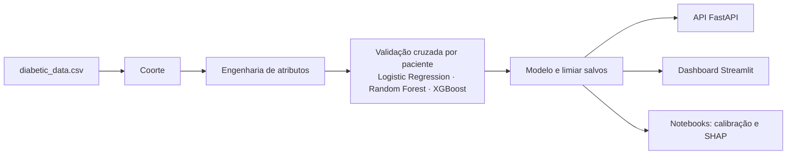
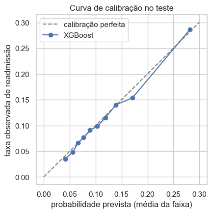
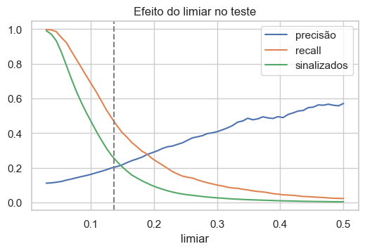
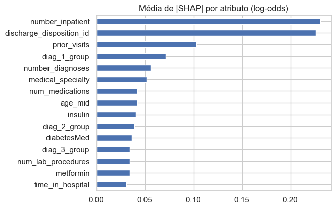

<h1 align="center">Previsão de Readmissão Hospitalar em 30 dias</h1>

<p align="center">
  Pipeline de Machine Learning que estima a probabilidade de um paciente com diabetes ser readmitido em menos de 30 dias após a alta, com API, dashboard e notebooks de explicação.
</p>

<p align="center">
  
  
  
  
  
  
  
</p>

<p align="center">
  <a href="#visão-geral">Visão geral</a> ·
  <a href="#resultados">Resultados</a> ·
  <a href="#como-rodar">Como rodar</a> ·
  <a href="#api-fastapi">API</a> ·
  <a href="#dashboard-streamlit">Dashboard</a> ·
  <a href="#notas-de-modelagem">Modelagem</a> ·
  <a href="#notebooks">Notebooks</a>
</p>

## Visão geral

O projeto usa o dataset *Diabetes 130-US hospitals* (UCI, 1999–2008), arquivo `diabetic_data.csv`, e cobre o caminho inteiro: dos dados brutos até uma decisão que a equipe de alta consegue usar.

| | |
|---|---|
| **Coorte** | 99.343 atendimentos de 69.990 pacientes |
| **Modelo vencedor** | XGBoost, escolhido por validação cruzada agrupada por paciente |
| **ROC-AUC no teste** | 0,680 |
| **Calibração** | previsto a menos de 2 pontos percentuais do observado em dez faixas |
| **Onde está o sinal** | internações anteriores e destino da alta |



O que cada parte entrega:

- **Pipeline** (`src/`, `scripts/train.py`): monta a coorte, cria os atributos, compara três modelos e salva o vencedor com o limiar de decisão.
- **API** (`api/`): endpoint `POST /predict` que recebe os dados brutos de um atendimento e devolve a probabilidade e a decisão.
- **Dashboard** (`dashboard/`): cinco abas que vão de onde a readmissão se concentra até quantos casos a equipe encontra com a capacidade de acompanhamento que tem.
- **Notebooks** (`notebooks/`): exploração dos dados, calibração, efeito do limiar e explicação por SHAP, commitados com as saídas.

> [!NOTE]
> Este é um projeto de estudo sobre um dataset público. Não é uma ferramenta clínica e não deve ser usado para decidir o cuidado de pacientes reais.

## Resultados

Treino de 2026-11-20 com `python scripts/train.py` (padrões: `test_size=0.2`, `random_state=42`), cerca de 5 minutos em CPU de 12 threads.

Coorte: 99.343 atendimentos de 69.990 pacientes, após remover 2.423 altas por óbito/hospice. Divisão por paciente: treino com 79.625 atendimentos (55.952 pacientes) e teste com 19.718 atendimentos (14.038 pacientes), sem paciente em comum.

<table>
  <tr>
    <td width="33%" align="center"></td>
    <td width="33%" align="center"></td>
    <td width="33%" align="center"></td>
  </tr>
  <tr>
    <td align="center"><sub><b>Calibração.</b> As probabilidades previstas batem com a taxa observada.</sub></td>
    <td align="center"><sub><b>Limiar.</b> Quanto se ganha em precisão e se perde em recall ao subir o corte.</sub></td>
    <td align="center"><sub><b>SHAP.</b> Dois atributos carregam a maior parte do sinal.</sub></td>
  </tr>
</table>

Validação cruzada agrupada no treino (5 folds, média ± desvio):

| Modelo | ROC-AUC | PR-AUC |
|---|---|---|
| Logistic Regression | 0,662 ± 0,008 | 0,216 ± 0,010 |
| Random Forest | 0,671 ± 0,007 | 0,223 ± 0,011 |
| **XGBoost (vencedor)** | **0,675 ± 0,008** | **0,233 ± 0,012** |

Teste (XGBoost, avaliado uma vez):

| Métrica | Valor |
|---|---|
| ROC-AUC | 0,680 |
| PR-AUC | 0,238 (prevalência 0,111) |
| Brier | 0,093 |
| Limiar (máx. F1 out-of-fold) | 0,137 |
| Precisão / recall / F1 no limiar | 0,203 / 0,472 / 0,284 |
| Matriz de confusão `[[VN, FP], [FN, VP]]` | `[[13486, 4044], [1155, 1033]]` |

As colunas mais importantes por permutação são `number_inpatient` (queda de 0,074 na ROC-AUC) e `discharge_disposition_id` (0,050); as demais ficam abaixo de 0,008.

> [!IMPORTANT]
> ROC-AUC entre 0,64 e 0,68 é o típico para este dataset. O modelo ordena risco melhor que o acaso, mas não separa bem os casos: no limiar escolhido, cerca de 1 em cada 5 alertas é uma readmissão real. Um ROC-AUC bem acima de 0,72 aqui deve ser tratado como suspeita de vazamento, por exemplo o mesmo paciente em treino e teste.

## Como rodar

Os comandos abaixo são para Windows/PowerShell.

### 1. Instalar

```powershell
cd health-project
python -m venv .venv
.venv\Scripts\Activate.ps1
pip install --upgrade pip
pip install -r requirements.txt
```

### 2. Obter o dataset

Coloque o arquivo em `data/diabetic_data.csv`.

Outra opção é deixar o script de treino baixar do Kaggle quando o arquivo não existir:

```powershell
python scripts/train.py --kaggle_dataset OWNER/DATASET
# ou
python scripts/train.py --kaggle_url https://www.kaggle.com/datasets/OWNER/DATASET
```

`--kaggle_dataset` usa a Kaggle CLI com o slug do dataset e `--kaggle_url` usa o `opendatasets` com a URL. Nos dois casos é preciso configurar o token do Kaggle em `%USERPROFILE%\.kaggle\kaggle.json` (Windows) ou `~/.kaggle/kaggle.json`.

### 3. Treinar

```powershell
python scripts/train.py --data_path data/diabetic_data.csv --test_size 0.2 --random_state 42
```

| Saída | Conteúdo |
|---|---|
| `models/best_model.joblib` | Pipeline completo (engenharia de atributos + pré-processamento + classificador). Recebe um DataFrame com as colunas brutas de `RAW_INPUT_COLUMNS`. |
| `models/metadata.json` | Modelo vencedor, colunas de entrada, limiar de decisão, versão do scikit-learn, contagens de linhas/pacientes e data do treino. |
| `reports/metrics.json` | Métricas de validação cruzada por candidato e métricas no conjunto de teste. |
| `reports/feature_importance.csv` | Importância por permutação (queda de ROC-AUC) de cada coluna de entrada, medida no teste. |
| `reports/test_predictions.csv` | Alvo real e probabilidade prevista de cada atendimento do teste, usado pelo dashboard. |

### 4. Testar

```powershell
python -m pytest -q
```

Os testes usam dados sintéticos e treinam um modelo pequeno em diretório temporário; não dependem de `data/` nem de `models/`.

## API (FastAPI)

```powershell
uvicorn api.main:app --host 0.0.0.0 --port 8000
```

| Endpoint | O que faz |
|---|---|
| `GET /health` | Informa se o modelo está carregado, qual é e o limiar em uso. |
| `POST /predict` | Recebe um JSON com as colunas brutas de `RAW_INPUT_COLUMNS` (em `src/feature_engineering.py`) e devolve a previsão. |

Em `POST /predict`, todos os campos são opcionais; campos ausentes são imputados pelo pipeline. Contagens negativas e chaves desconhecidas são rejeitadas com 422. A decisão usa o limiar salvo em `models/metadata.json`.

<details>
<summary><b>Exemplo de requisição</b></summary>

```json
{
  "age": "[60-70)",
  "gender": "Female",
  "race": "Caucasian",
  "admission_type_id": 1,
  "discharge_disposition_id": 1,
  "admission_source_id": 7,
  "time_in_hospital": 5,
  "num_lab_procedures": 40,
  "num_procedures": 1,
  "num_medications": 12,
  "number_outpatient": 1,
  "number_emergency": 0,
  "number_inpatient": 0,
  "number_diagnoses": 9,
  "A1Cresult": "None",
  "max_glu_serum": "None",
  "insulin": "Steady",
  "metformin": "No",
  "glyburide": "No",
  "glipizide": "No",
  "pioglitazone": "No",
  "rosiglitazone": "No",
  "change": "Ch",
  "diabetesMed": "Yes",
  "diag_1": "428",
  "diag_2": "250.01",
  "diag_3": "401",
  "medical_specialty": "InternalMedicine"
}
```

</details>

Resposta: `model`, `probability_readmit_30`, `threshold` e `prediction` (1 se a probabilidade for maior ou igual ao limiar).

## Dashboard (Streamlit)

```powershell
streamlit run dashboard/app.py
```

Rode a partir da raiz do projeto, para o tema em `.streamlit/config.toml` ser aplicado. O painel precisa do dataset em `data/` e do treino já executado.

Uma linha de filtros (faixa etária, tipo de admissão e gênero) recorta os indicadores do topo e as duas primeiras abas.

| Aba | Pergunta que responde |
|---|---|
| Panorama | Onde a readmissão se concentra: por internações anteriores e por destino da alta. |
| Fatores de risco | Como a taxa varia em cada variável, quanto cada grupo pesa no volume e quais são os dez grupos de maior taxa. |
| Desempenho do modelo | O modelo ordena o risco, as probabilidades batem com o observado, qual candidato venceu e quais colunas carregam o sinal. |
| Limiar e capacidade | Dada a parcela de altas que a equipe consegue acompanhar, quantas readmissões são encontradas e perdidas a cada mil altas. |
| Paciente | Risco previsto para uma alta, comparação com a média e os atributos que mais pesaram na previsão. |

Cada gráfico tem a tabela correspondente em "Ver dados". O código está em `dashboard/` (telas e gráficos) e em `src/analysis.py`, `src/dimensions.py`, `src/labels.py` e `src/explain.py` (cálculos, com testes).

## Notas de modelagem

**Alvo e coorte**

- Alvo binário: `readmit_30 = 1` se `readmitted == "<30"`, caso contrário `0`.
- Atendimentos com alta por óbito ou para hospice (`discharge_disposition_id` em 11, 13, 14, 19, 20, 21) são removidos, pois não podem gerar readmissão. Todos os demais atendimentos de cada paciente são mantidos.

**Valores ausentes**

- Apenas `?` e `Unknown/Invalid` são tratados como ausentes.
- Em `A1Cresult` e `max_glu_serum`, `"None"` significa "exame não realizado" e é mantido como categoria própria.
- Categóricas ausentes viram a categoria `"missing"`; numéricas ausentes recebem a mediana.

**Engenharia de atributos**

`engineer_features` é o primeiro passo do pipeline salvo, então treino e inferência usam o mesmo código.

- `age_mid`: ponto médio da faixa etária
- `medication_ratio = num_medications / max(1, time_in_hospital)`
- `prior_visits = number_outpatient + number_emergency + number_inpatient`
- `diag_1`, `diag_2`, `diag_3` mapeados para grupos de ICD-9 (Strack et al., 2014)
- `admission_type_id`, `discharge_disposition_id` e `admission_source_id` tratados como categorias
- categorias com menos de 0,1% das linhas são agrupadas como infrequentes no one-hot

**Divisão, seleção e limiar**

- Divisão: 20% dos pacientes vão para o teste (`StratifiedGroupKFold` por `patient_nbr`); nenhum paciente aparece em treino e teste.
- Modelos testados: Logistic Regression, Random Forest e XGBoost, sem pesos de classe para manter as probabilidades interpretáveis.
- Seleção: validação cruzada de 5 folds agrupada por paciente (`StratifiedGroupKFold`) no treino; vence a maior ROC-AUC média. A PR-AUC é registrada para cada candidato.
- Limiar: o que maximiza o F1 nas probabilidades out-of-fold do vencedor. O vencedor é reajustado no treino completo e avaliado uma única vez no teste.

## Notebooks

Os notebooks estão commitados com as saídas, então dá para ler sem executar.

| Notebook | Conteúdo |
|---|---|
| [`01_eda.ipynb`](notebooks/01_eda.ipynb) | Explora a coorte: alvo, valores ausentes, pacientes repetidos e taxa de readmissão por variável. |
| [`02_modelo_shap.ipynb`](notebooks/02_modelo_shap.ipynb) | Avalia o modelo salvo no conjunto de teste: curva de calibração, efeito do limiar e explicação por SHAP. Rode o treino antes. |

Para executar de novo:

```powershell
python -m nbconvert --to notebook --execute --inplace notebooks/01_eda.ipynb
python -m nbconvert --to notebook --execute --inplace notebooks/02_modelo_shap.ipynb
```

O que eles mostram:

- O histórico de internações e o destino da alta concentram o sinal. A taxa de readmissão vai de 8,6% sem internações no ano anterior a 37,1% com cinco ou mais, e de 9,3% na alta para casa a 27,7% na alta para reabilitação.
- As probabilidades estão bem calibradas: em dez faixas do teste, o previsto fica a menos de 2 pontos percentuais do observado.
- No SHAP, `number_inpatient` (0,231) e `discharge_disposition_id` (0,226) têm o dobro da média de |SHAP| do terceiro atributo, o que concorda com a importância por permutação.

## Estrutura

```
health-project/
├─ data/                     # coloque aqui o diabetic_data.csv
├─ models/                   # artefatos treinados (.joblib, metadata)
├─ reports/                  # métricas e importâncias
├─ docs/img/                 # figuras usadas neste README
├─ src/
│  ├─ data_loading.py        # leitura do CSV e montagem da coorte
│  ├─ feature_engineering.py # contrato de entrada e engenharia de atributos
│  ├─ modeling.py            # divisão, validação cruzada, limiar, treino e artefatos
│  ├─ artifacts.py           # carga do modelo salvo e predição de um registro
│  ├─ analysis.py            # taxas por grupo, faixas de risco e curvas de limiar
│  ├─ dimensions.py          # variáveis de análise derivadas da coorte
│  ├─ labels.py              # nomes em português de atributos e categorias
│  ├─ explain.py             # contribuição de cada atributo para uma previsão
│  └─ kaggle_utils.py        # download opcional do dataset
├─ scripts/
│  └─ train.py
├─ api/
│  └─ main.py                # FastAPI
├─ dashboard/
│  ├─ app.py                 # Streamlit: filtros, indicadores e abas
│  ├─ views.py               # conteúdo das abas de análise
│  ├─ patient.py             # formulário e resultado de um paciente
│  └─ charts.py              # gráficos (Altair)
├─ notebooks/
│  ├─ 01_eda.ipynb           # exploração dos dados
│  └─ 02_modelo_shap.ipynb   # calibração, limiar e SHAP
├─ tests/                    # pytest
├─ requirements.txt
└─ README.md
```

## Fonte do dataset

- Kaggle: `Prediction on Hospital Readmission` (arquivo `diabetic_data.csv`)
- Origem UCI: Diabetes 130-US hospitals for years 1999–2008
- Strack, B. et al. (2014). Impact of HbA1c Measurement on Hospital Readmission Rates. BioMed Research International.
